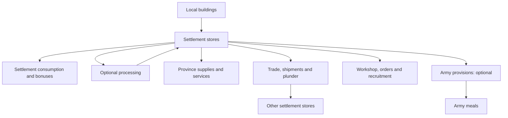

# Derpy Resource Overhaul: mechanics reference

Source-checked **21 October 2026**. The essential-goods and half-full starting-cargo revision is locally deployed and MCP-verified through three owner-turn cycles and exact cold reload. The processed-only Hardtack Exchange supply gap was fixed during that test. See the [native evidence and limits](sessions/LIVE_TEST_20261021_ESSENTIAL_GOODS.md). Game closed and original settings restored; no Workshop publication. The later [service-label fix](sessions/HANDOFF_20261021_SERVICE_BENEFIT_LABELS.md) (main `e75ce0c9`, deployed and native-checked) makes the Settlements view show each service's real benefit (`-5% cost`, `+3% replen.`, `+5 growth`) instead of labelling every service except Civic Records as control.

The later [terrain-route addition](sessions/HANDOFF_20261021_TERRAIN_TRADE_ROUTES.md) draws faction-coloured dashed paths on the 3D campaign map, around impassable terrain and across water, and since 2026-10-22 round land hostile to either party wherever a detour exists; the line size and colours are MCT choices (Campaign settings, below). Cargo indicators track existing saved shipment positions; the Vault Map draws the same roads. Since 2026-10-22 an agreement's road also decides whether it trades ([Trade reach](#trade-reach-2026-10-22)). Main `3AE6E88B`, deployed to `data/` 2026-10-23 ([route logic](sessions/HANDOFF_20261023_ROUTE_LOGIC.md)); nearby routes merge into shared corridors on both maps, carts and dashes round corners, and Small is the default line size ([current handoff](sessions/HANDOFF_20261022_TRADE_ROUTES_CURRENT.md)). Rendering is single-player only; the routes do not model army zones of control. Since 2026-11-02 an enemy army near a road stops that pair's trade for the turn without rerouting it ([Tolls and blockades](#tolls-and-blockades-2026-11-02)).

Since 2026-10-24 every store has its own price, set by how short or full it is ([Local prices](#local-prices-2026-10-24)). Selling, partner contracts and agreement trade all read it. Since the same day an agreement's goods travel the road between the two capitals as a convoy that can be seized on the way, and shipments take their road's length ([Cargo on the road](#cargo-on-the-road-2026-10-24)). Main `74088FE5`, deployed to `data/` 2026-10-24 and checked in game the same day ([live check](sessions/LIVE_TEST_20261024_LOCAL_PRICES_AND_CARGO.md)).

## Contents

1. [Purpose and current scope](#purpose-and-current-scope)
2. [Goods, production and storage](#goods-production-and-storage)
3. [Reserves, targets and forecasts](#reserves-targets-and-forecasts)
4. [Trade, duty and selling](#trade-duty-and-selling)
5. [Shipments and capture](#shipments-and-capture)
6. [Settlement consumption and spending](#settlement-consumption-and-spending)
7. [Workshop and recruitment](#workshop-and-recruitment)
8. [Processing and services](#processing-and-services)
9. [Army provisions](#army-provisions)
10. [Interface, settings and AI](#interface-settings-and-ai)
11. [Implementation status and limits](#implementation-status-and-limits)
12. [Source ownership and evidence](#source-ownership-and-evidence)

## Purpose and current scope

The mod turns trade goods into physical settlement stocks. Buildings produce goods; settlements retain them; trade, shipments and plunder move them; armies, recruitment, services and purchases consume them. Location matters for recurring settlement costs and army resupply, while several deliberate purchases can draw across the realm.

It supplements the native campaign economy. Gold income, native trade agreements, recruitment buildings and normal recruitment costs continue to exist.

The numbered expansion priorities are: **#1 stock policies**, **#2 Exchange appetites**, **#3 processing**, **#4 sustained services**, **#5 army provisions**, and **#6 trade routes/contracts**. Numbers 1, 3, 4, 5 and 6 are implemented in the main local build. Number 2 is implemented in the separately deployed Exchange build; it changes demand while preserving investment fund baskets.

## Goods, production and storage

### Resource catalog

There are **58 stored goods: 41 added goods and 17 native goods**. Each belongs to one spending category. The eight **bold** goods are rare: ordinary category spending excludes them, although exact recipes and rare Workshop purchases can consume them.

| Category | Goods |
|---|---|
| Provisions | Hardtack, Grain, Salted Fish, Salted Meat, Olive Oil, Tea, Kvas, Mead, Rum, Beer, Wine, Spices, Salt, Medicine |
| Building materials | Cloth, Tools, Timber, Marble, Pottery, Glassware, **Starwood** |
| War materials | Leather, Iron, Coal, Brass, Blackpowder, Brimstone, **Gromril**, **Ithilmar**, Quicksilver, Obsidian, Whale Oil |
| Mount supplies | Warhorses, **Griffon and Pegasus Feathers**, Rhinox Hides, **Wyvern Scales**, **Dragon Bone**, **Sea Dragon Hide**, Animals, Tusks, Furs |
| Luxuries | Silk, Jade, Arabyan Carpets, Porcelain, Pearls, Amber, Lustrian Plumes, Incense, **Black Lotus**, Pipeweed, Books, Gems, Gold Idols, Dyes, Trinkets, Silver, Wool |

These categories describe what goods can pay for. They are not separate pooled currencies: a store still holds each individual good.

### Production

The mod attaches production to existing buildings using culture, location and building conditions. Farms, ports, mines, industry and specialist buildings supply different goods. It does not edit the campaign start-position map or guarantee every culture a local producer for every good. Trade and conquest therefore matter.

Existing farm chains produce Grain without homeland/climate gates; existing hunting chains produce Salted Meat without the old Ogre/Mountains of Mourn restriction. Chaos Dwarfs, Greenskins, Warriors of Chaos, Skaven, Cathay and Norsca also receive Salted Meat from ordinary main-settlement chains at **8/12/16/20/24** by chain level. These are local provision levies, not new buildings or goods. Damaged production is halved and ruined production is zero. Production on supported map-specific primary chains follows the same rule.

Ordinary output fills native settlement resource pools. Capacity limits what can be retained. Passive building production continues when optional processing is disabled. Hunting chains also supply Leather, craft chains supply Cloth, and metalworking chains supply Tools. Hardtack has no passive building source: it is made from Grain and Salt through processing, or issued once as starting army cargo. The Exchange counts a completed biscuit batch from the current or previous turn as supply, attributed to its still-current owner; an idle bakery does not create market supply.

The eight rare goods also have dedicated three-level production chains. Availability is restricted by culture and eligible geography/deposits:

| Rare good | Main eligible producers and locations |
|---|---|
| Gromril | Dwarfs; qualifying mountain deposits |
| Ithilmar | High Elves; qualifying Ulthuan deposits and Vaul's Anvil |
| Dragon Bone | Eligible cultures at specified dragon grave sites, including Caledor and the Plain of Bones |
| Sea Dragon Hide | Dark Elves; qualifying cold Naggaroth ports |
| Black Lotus | Dark Elves and Skaven; qualifying Southlands/Khuresh jungles |
| Starwood | Wood Elves; Athel Loren |
| Griffon and Pegasus Feathers | Empire and Bretonnia; qualifying mountain regions |
| Wyvern Scales | Greenskins and Ogres; qualifying Badlands/Mountains of Mourn regions |

The Vault's eligible-location view is the practical source for a particular campaign. A regional name alone does not bypass culture, building or slot requirements. Rare-building levels cost **1,000 / 2,000 / 3,000 gold**, requiring settlement tier **1 / 2 / 3** respectively. These production buildings are separate from paid Workshop settlement upgrades.

Main campaign support includes Immortal Empires and Realm of Chaos; `_iee` and `_oldworld` companion packs supply their map-specific compatibility data.

### Storage and culture eligibility

Capacity is **per good, per settlement**, rather than a shared warehouse total. Main-settlement tiers provide 200-unit capacity steps up to 1,000. Damage does not remove the settlement's capacity. Production cannot create unlimited overflow.

Occupation retains the settlement's remaining stocks for its new owner. Razing or abandoning removes the settlement pools. Ownership and capacity are checked again when goods arrive or actions execute.

Stores gameplay excludes Daemons of Chaos, the four monogod daemon cultures, Tomb Kings, Nagash and Beastmen. **Vampire Counts and Vampire Coast retain stores and trade but do not consume settlement or army meals.** Their old army shortage records and penalties retire through the normal owner-turn cleanup. Production is a separate layer: an excluded owner can still possess a captured building with native production effects; that does not make all stores actions available to it.

### Spoilage (2026-11-01)

Grain rots (4% a turn) and Beer and Kvas sour (2%), on what a store holds above a **safe share** of that good's space: 25%, or 50% for Grain once the faction has built the Great Granary. The loss is `floor(exposed x rate / 100)`, so a small excess loses nothing, and every other good keeps - the preserved forms (Hardtack, salted meat and fish, Wine) are the answer. It runs at the owner's turn start, after the meals and before processing and trade, books on its own factor (Spoiled), and applies to computer factions under the same switch as their other stores actions. Vampire Counts and Vampire Coast eat nothing, but their grain still rots. The settlement view's row tooltip gives the safe amount and next turn's expected loss, forecasts take it off the net but not the cover, since it stops at the safe share and cannot empty a store, and each good's Last turn line shows what spoiled. The ledger is kept per faction and good, so there is no per-store record of last turn's loss.

## Reserves, targets and forecasts

### Automatic defaults and per-resource overrides (#1)

**Keep** is the reserve below which an outward transfer should stop. **Target** is the amount incoming scripted trade should try to reach. Each resource can use automatic policy or explicit overrides.

Automatic policy normally reserves **five turns** of recurring demand and targets **ten turns**. Demand includes settlement food, enabled province supplies, and exact inputs of enabled processing and services. War materials and luxuries also account for the stock needed to maintain holding bonuses. Named inputs keep their identity: a Books requirement cannot be satisfied merely by importing unrelated luxuries. The calculation avoids counting the same recurring use twice.

Targets account for cargo already on its way and available storage. Rare goods can have Workshop purchase targets rather than being treated as disposable category stock. Automatic policy is recalculated as demand changes; explicit settings let the player choose a different reserve or target.

Eligible armies with Auto-refill enabled add their meal requirements to the current owned, unsieged land region's recurring food forecast, five-turn reserve and ten-turn target. Multiple visiting armies add together. Moving away, pausing Auto, embarking or losing local eligibility removes that region's army demand. Forecasts assume the current armies stay; they do not predict marching orders.

### What Keep protects

| Action | Treatment of reserves |
|---|---|
| Scripted exports, internal shipments and selling | Use removable stock above Keep, including automatic reserves for local armies |
| Army loading | Can consume the army portion of Auto Keep, while retaining essential/named reserves and explicit per-resource Keep |
| Optional processing | Inputs must remain affordable above Keep |
| Sustained services | Preserve five turns of base essential/province-supply demand; ignore explicit Keep and named-input reservations for their own payment |
| Settlement meals, province-supply payments, recruitment, manual orders, events and Workshop purchases | Can spend held stock, including reserves |

Keep is therefore a logistics policy, not a universal spending prohibition. A large manual purchase can still leave a settlement below its preferred reserve.

Forecasts combine known production, recurring use and committed incoming cargo. They are estimates, not promises of future imports, successful processing batches or safety from plunder. Opening previews does not spend goods or advance the economy. History retains **20 turns**.

## Trade, duty and selling

### Three different trade systems

| System | What it does |
|---|---|
| Native CA trade | Continues to calculate normal trade income from agreements and production |
| Scripted stock trade | Moves actual stored goods between treaty partners to meet recipient targets |
| Optional Grand Trade Exchange | Supplies its own market, prices and investments; installed separately |

Scripted stock trade runs on the exporter's turn. For each good and partner it selects the exporter's cheapest store holding that good (the lowest local price; ties go to the one with more to spare, then the region key), then sends up to **5%** of what that store can spare by default, rounded down but never under 1 while it has any to spare (since 2026-10-30; rounded down to 0, half the computers' spare goods on open roads moved nothing). Before 2026-10-24 it took the store with the largest removable surplus, which is usually a large, comfortable capital. The recipient's target deficit and free space limit the transfer. Since 2026-10-24 a good also moves only uphill: the partner capital's local price must be at least the source store's buy price ([Local prices](#local-prices-2026-10-24)), so two comfortable stores trade nothing. A store with no price on either side moves nothing. Since 2026-10-24 the goods no longer arrive at once: they leave as a convoy that travels the road to the partner's home capital ([Cargo on the road](#cargo-on-the-road-2026-10-24)).

For example, 100 removable units permit a five-unit export at the default rate, provided the partner needs five and can store them. The calculation does not export 5% of the entire realm's combined holdings from every settlement.

The Trade tab supports per-resource import and export holds. Export holds also use production-marker effects to suppress the corresponding production available for native export; they do not delete existing stores. Import holds stop scripted partner imports and partner contract carts. Either hold also stops the faction's own carts of that good, because every cart goes through `F.ship`, which checks both: manual Send here, standing supply and army relief (flows harness: "relief respects export hold", "relief respects import hold"). Since 2026-11-10 `F.send_plan` checks them too, so Send here greys out with the reason instead of doing nothing. Import duty is paid either way.

### Trade reach (2026-10-22)

An agreement moves stored goods and import duty only while **a road joins the two home capitals that takes no more than the reach** (default **6 turns**, 1–10, at 40 hexes a turn, so 240 hexes) **and keeps off land hostile to either side**. Hostile land is a region owned by a faction at war with either partner, by rebels, or by a faction whose attitude to either partner is **-70 or worse** (the diplomacy screen's "very unfriendly"). The partners' own regions never count. The road is a hex search on the installed map's pathfinding grid (`R.reach` in `terrain_routes.lua`), with hostile land as a wall and the reach as a length limit, so one search answers both "too far" and "cut off by enemy lands"; the reason is the second when a road through hostile land would have been short enough. A map with no generated grid never stops trade.

The answer is worked out once per pair per turn by whichever partner's turn start asks first, which is the same on every machine. The Trade tab lists the partners cut off, with why, in a **Trade cut off** row under Import duty. On the 3D map an agreement that is cut off draws no line, and one that runs draws the road the trade uses. **Native CA trade income is not affected**: the engine pays it from the agreement itself, and the only lever there is the per-good, faction-wide export hold.

Timing measured offline on the Immortal Empires grid (stock Lua 5.1, no engine lookups): an open road 7 ms, a detour round enemy land 29 ms, a capital ringed by enemies 10 ms, the worst case found (a long enemy wall) 101 ms at 6 turns and 348 ms at 10. A pair further apart than the reach in a straight line is rejected before any search. In game (vanilla Immortal Empires, 2026-10-22) a search took 9-341 ms from Uzkulak and 746 ms at worst (Altdorf to Karak Norn, cut off by enemy land); 12 agreements cost 1.3 s at the player's turn start. With "goods move between other factions" on (the default) computer-to-computer agreements are judged too, and 42 of them took about 4 s of one end turn, 7.6 s in a 20-partner test. Since 2026-10-23 the native grid edges are decoded once per hex and reused, which took the same 107 pairs from 7.4 s to 4.0 s warm with identical answers. **The author decided on 2026-10-23 to keep computer-only pairs on the full rule for now.** The recorded alternatives are caching a computer-only pair's answer for a few turns, or skipping the rule between two computer factions.

Reach answers are dropped and worked out again the same turn when war is declared, on a positive or negative diplomatic event, and when a region changes owner (`F.invalidate_reach`, 2026-10-23). Queued route searches and the bundled road network are dropped with them. An attitude change made by script without one of those events waits for the next turn's answer.

**Kept answers (2026-10-29).** Working an answer out again no longer means searching again. `R.reach` keeps each road's answer with the verdict of every region its search looked at, and gives it again while each of those regions still judges the same (`R.unchanged`). The search depends on the terrain and those verdicts and nothing else, so a kept answer is the one a new search would give: the rule, every answer and every road are unchanged, and machines agree whatever each has kept. A war, a capture or an attitude crossing -70 searches again only the pairs whose search touched that land. The road through hostile land as well, which only names the reason, depends on terrain alone and is kept for the campaign; a pair with no road even through it answers "too far" without the walled search. Offline (the Immortal Empires grid, 120 pairs at 6 turns, a stub world): a round with nothing changed 7.7 s to 44 ms, one war changed 120 ms, a cold round (the first after a load) 9.7 s to 7.4 s, every answer and road identical. In game, on the 10-24 fixture, the computers' turn handlers went from 12.4-14.5 s to 6.2 s in the first round after a load and 4.2 s in the next. [TRADE_RESOURCES.md §53](TRADE_RESOURCES.md#53-kept-reach-answers-2026-10-29).

**Dragging the map (2026-10-29).** A camera move only places what is near the camera, from the last refresh's links, goods and shared stretches. The full refresh (links, cart goods from trade previews) runs on a change, and on the 2.5 s timer once the camera is still. [TRADE_RESOURCES.md §54](TRADE_RESOURCES.md#54-map-redraw-while-dragging-2026-10-29).

**The map at a war or diplomatic event (2026-10-30).** Every such event clears the reach answers and asks the map to check its roads again. Nothing is drawn differently until an answer actually moves:

- **Roads.** A shown road whose regions all still judge the same is given back unsearched (`R.path`, as `R.reach`), and a changed one keeps its old line until the new search lands.
- **Agreement lines.** An agreement whose new reach answer is still being worked out keeps its last line.
- **Network.** It is bundled again only when a road or a link really changes, and at the player's turn.
- **Cart goods.** Their trade previews are kept, and one seller is renewed every 0.5 s. A player's action through the panel (a trade switch, a stock rule, a sale, an order) has them all worked out again on the next tick.

In game, the map's share of the computers' turns fell from 9 to 12 s a round to 0.74 s, and a still camera's timed refresh from 37 to 62 ms to 10 ms at most. [TRADE_RESOURCES.md §55](TRADE_RESOURCES.md#55-route-map-during-the-computers-turns-2026-10-30).

### Local prices (2026-10-24)

Each store prices each good from its own stock. The **base** is the per-unit price Sell has always used: the Exchange's sell price when a compatible Exchange is installed, otherwise **1, 2, 3, 4 or 5 gold** by category. The base is multiplied by **25% to 175%**:

- **A bulk good this settlement uses up** (it has a recurring use for the category): cover is the category's total stock divided by its use per turn, rounded down to whole turns. Any good of the category counts, because any of them feeds that use. The multiplier is `floor(75 * imbalance / 100) + 100`, with `imbalance = clamp(floor((10 - cover) * 100 / 10), -100, 100)`. Ten turns is the import target (`F.SHIP.ai_on`).
- **Any other good** (rare, or a category the settlement does not use): `imbalance = clamp(100 - floor(held * 200 / capacity), -100, 100)`, so empty is 175%, half full 100% and full 25%.
- **No pool or no room** for the good: no price. Nothing is sold from that store, and a contract or trade that needs a price there does not move.

The five pinned points on the cover rule:

| Cover (turns) | 0 | 5 | 10 | 15 | 20 or more |
|---|---|---|---|---|---|
| Multiplier | 175% | 137% | 100% | 62% | 25% |

Prices are whole **hundredths of a gold** in the model and the save (`F.PCT = 100`): `price = floor(floor(base * 100) * mult / 100)`. A buyer pays `floor(price * 110 / 100)` and a seller gets `floor(price * 100 / 110)` (`F.SPREAD = 10`), so a round trip loses about 17%. Gold for `n` units is `floor(n * price / 100)`. A full war-materials store prices at 0.75, buyers pay 0.82, sellers get 0.68, and ten units at 0.75 are 7 gold. Nothing is stored: the price is worked out from the stock view each time it is read, so a reload cannot disagree with a live game. Every constant sits right of its operator, because the game's compiler miscompiles a literal on the left.

`F.quote(faction, region, stem)` returns `price, buy, sell, mult, base` and `cover` or `fullness`. The Resource Vault reads it and never repeats the formula: the settlement view and the good drill-down have a **Price** column, the full mark sits in the Held / Space cell, and the price tooltip reads, for example, "The price is 0.75 instead of 3.00." then "It is cheap because the stores hold 20 turns of war materials." then "You buy for 0.82 and sell for 0.68." A good's Trade rules show "Price at capital", the figure partners' stores are compared with.

Each store is priced at its own faction's base. Without the Exchange every faction's base is the same category price; with it, the houses' opinion of each faction moves its base, so an agreement's goods also lean toward the faction that values them more. The partner capitals' own prices are not shown yet (deferred to the tolls design).

Import duty, the recruitment draw, the Workshop, army provisions and escorts do not use local prices.

### Cargo on the road (2026-10-24)

At the exporter's turn start, everything it sends one partner that turn leaves together as **one convoy**. The goods are taken from the source stores at once and travel the road the [reach check](#trade-reach-2026-10-22) found between the two capitals, from the exporter's end; no new search is made. Travel time is the road's length in **hexes** at **40 a turn** (`F.ROAD_PER_TURN`), at least one turn and never more than the trade reach (default 6). A bridge (a sea or river crossing) is one point on the road but counts its whole span, as the reach search charged it (`F.road_steps`). On a map with no route grid a convoy takes one turn. What was instant is now at least one turn.

At each of the exporter's turn starts, in the order they left, each convoy:

1. **Returns** if the agreement has ended (war included) or the buyer is dead or has no settlement. The goods go back to the exporter's settlement nearest the convoy; an exporter with no settlement loses them.
2. **Takes the pair's road of the day** (since 2026-11-01, `F.convoy_on`), when the reach check has an open road for the two capitals that still leaves the exporter's end. It goes the same share of the way along that road, and its due turn stays as it was. A cut-off pair, or a road from a capital that has moved, leaves it on its own road.
3. **Is seized** if an army at war with the exporter stands within **3 hexes** (`F.SHIP.near`) of it. The goods go to the captor's nearest settlement, with the ledger lines a seized shipment gets. A convoy is checked only where it stands at the exporter's turn start, so a one-turn convoy is exposed only at the exporter's capital. There is no escort and no battle.
4. **Arrives** on its due turn, into the buyer's current capital up to its free space; the rest is lost.
5. Otherwise **moves on** to the point that share of the way along the road.

A dead exporter's convoys are removed, goods and all, at the next player's turn start. Cargo on the road counts as incoming at the buyer's capital (`F.ships_to`), so its import need, the forecasts and the next turn's trade see it, and a partner is not sent the same shortfall every turn while the first load travels. Duty is unchanged: paid on what the partner made this turn, arrived or not. Convoys are saved in `F.state.convoys`, each road packed into one string (`"x:y;x:y"`); a save from before this change loads with none, and a malformed record is dropped at load.

**Seeing it.** The Trade tab has a **Cargo on the road** row ("2 out, 1 in") whose tooltip lists the eight that land soonest, with their goods and turn, then "and N more convoys". A good's drill-down lists convoy cargo with what is coming in. The Vault Map and the 3D campaign map draw a convoy marker on the road. The 3D map draws the viewer's own convoys, those bound for the viewer, and a met faction's between two capitals the viewer can see; only near the camera, and only while shipments are shown. A road can change in the middle of a round. The 3D map then draws the marker where step 2 will move the convoy, on the pair's road as drawn that moment, so the marker never sits on yesterday's road. Corridor merging can still draw the dashes up to six tiles off that road (`R.bundle`). Several convoys at one spot on the Vault Map share one marker whose tooltip lists them, and the Vault Map stays framed on the realm. **The turn shown is when the buyer first has the goods**: a computer partner's convoy lands during that partner's turn, after the player's, so a player buying from a computer sees it a turn after the convoy's due turn (`F.convoy_due`).

### Import duty

At the payer's turn, trade partners can receive a duty based on their current production value: **10% by default**, rounded down and capped by the payer's remaining treasury. The value uses native resource trade values, not the Exchange's market quote.

Duty is a gold transfer between factions. It is based on production rather than the exact quantity of stock delivered that turn, and can apply even when a particular import target is already full. It is additional to native treaty income. A partner out of trade reach pays and receives no duty.

### Tolls and blockades (2026-11-02)

**Tolls.** Agreement trade and partner contract carts pay a toll to each faction whose lands their road crosses: the **Tolls** setting's share of the cargo's value per faction (**3% by default**), rounded down, and **at most 15%** for all of them together. The exporter pays for agreement trade; the buyer pays for a contract cart. Internal shipments pay none. These never charge: the two trading factions, rebels, a faction whose Roads edict is Open or Closed, and an ally, vassal or client state of either side. A faction whose lands the road crosses twice is paid once.

Tolls are paid in full or not at all. Agreement trade only sends a good whose price at the partner covers the buying price plus the toll, and a partner whose tolls the exporter cannot pay this turn gets nothing. Guards hired for an earlier partner's cargo count against the same treasury. A contract cart whose tolls the buyer cannot pay does not leave. The tolls are paid when the cargo leaves and are recorded on it.

**Blockades.** An army at war with either side, standing within **3 hexes** of any point of the road, stops that pair's agreement trade, its import duty and its contract carts for the turn. Cargo already on the road goes on. A blockade never reroutes a road. The Trade tab's Trade cut off row names the blocker ("Blockaded by Name"), a contract's status reads "Blockaded", and both maps stop drawing the pair's line until its trade runs again. A blockade is kept in the save for the turn it was seen and the next, so a reload shows and charges the same.

**On screen.** The Trade tab shows last turn's Tolls paid and Tolls received under Import duty, each with a line per faction in its tooltip. A cargo's tooltip lists the tolls it paid. MCT switch **Tolls and blockades** (on); off, nothing pays a toll and nothing is blockaded.

Not seen in game. Design and checks: [TRADE_RESOURCES.md §64](TRADE_RESOURCES.md#64-tolls-and-blockades-2026-11-02).

### Selling excess

A sale can remove only stock above Keep **and** above half the realm's combined capacity for that good. It is not a button to liquidate every holding.

Since 2026-10-24 the sale draws from the store with the most to spare first (ties by region key), and each store's units are paid at that store's own sell price ([Local prices](#local-prices-2026-10-24)). Each store's gold is rounded down on its own, and a store whose share rounds to 0 gold sells nothing. A realm of full stores sells cheap. The Sell tooltip gives the average price a unit, names up to eight stores with their amounts and prices, then counts the rest. Selling creates gold; it does not create an internal shipment or a new diplomatic contract.

## Shipments and capture

### Internal shipments

Manual **Send here**, standing province supply and recurring named orders move goods between owned settlements. They respect source reserves, import/export holds, destination capacity and incoming commitments. Newly dispatched carts carry at most **100 gross units** and take their saved road's length in **hexes at 40 a turn, 1 to 6 owner turns**, saved at dispatch (since 2026-10-24; before, the straight-line distance). A cart with no saved road, and the panel's estimate before dispatch, use the longer of the two coordinate spans over 40, a lower bound on any road, which the panel shows as "at least N turns". Each loses **10% of its dispatched amount, rounded up**. A 100-unit dispatch therefore carries 90 units to arrival. Existing carts keep their saved due turn, with the former two-turn rule only as a fallback for missing due data.

The default simultaneous limit is **three shipments for a human faction**, configurable from one to ten, and **one for AI**. Cargo leaves the source immediately. On supported maps, new shipments save a traversable road at dispatch, preferring detours around hostile territory. At each owner turn the cargo, caravan scene and interception trigger advance to the same point along that saved road. The 3D line and Vault Map use that road too. Travel time comes from that road (above); movement is per turn, without continuous animation. Older shipments, unsupported maps and failed searches retain the former source/destination staging. A saved journey is not rerouted when diplomacy changes. Separately, up to sixteen rigid vehicles provide nearby visual traffic: minecarts on land and [low-poly boats at sea](sessions/HANDOFF_20261023_LOW_POLY_TRADE_BOATS.md). [Supplier culture chooses nine land families and 23 ship styles](sessions/HANDOFF_20261023_FACTION_TRADE_VEHICLES.md), with shared land fallbacks where needed. Each model retains only its final LOD (up to 1,909 triangles and four meshes), shares the total sixteen-vehicle cap, and reuses native textures and the existing movement callback. Empty returns retain their prior supplier vehicle. No FPS delta has been measured. They glide between points and turn back at endpoints; they do not represent the precise location of an interceptable shipment. Every route in view gets one vehicle before any route gets a second, return vehicle. Vehicles depart independently, keep four hexes apart along shared hexes, reverse at the destination and return within the same campaign turn. A one-way route drives no empty leg. Animation never moves stock. [Cargo selection previews the real allocator](sessions/HANDOFF_20261023_TRADE_TRAFFIC_ACCURACY.md), respecting switches, reserves, recipient demand/capacity, incoming cargo, rate/rounding and ordered shared surplus. Empty returns carry no resource icon; zero-flow agreements retain the road without vehicles. No skeletal or wheel animation is played. This display runs only in single player.

Standing supply pulls eligible category goods from owned minor settlements in the same province. It starts replenishing below five payments' worth at the capital, counting incoming cargo, and aims toward ten payments' worth. The normal shipment cap and travel loss still apply.

If the destination is lost, arriving cargo tries the owner's settlement nearest the original destination. Without a surviving recipient settlement it is lost. Capacity still limits delivery.

### Recurring named orders and paid contracts

Click a settlement resource, or open a resource's Trade rules, to choose an owned or treaty-partner source. **Create** accepts the displayed destination, named good, net stock target and gross batch cap. Edit the order under **Spending**: target steps by ten (minimum one), batch is 2–100, and each control's default is 100. Up to 50 orders per buyer; identical source/destination/good orders cannot be duplicated. Pause stops future dispatch; Cancel removes the order.

Each owner turn, an enabled order requests only `target - local stock - committed net cargo`, limited by free capacity, source Keep, holds and cart space. At most one dispatch per order per turn. A named order replaces standing category dispatch to that destination, including while paused until cancelled. Multiple sources share incoming reservations. There are no independently enabled AI purchase contracts; existing AI standing supply and army relief use the new cart bounds.

An internal order costs no gold, so a faction in debt still sends one. A **partner contract** requires a current trade agreement, a buyer-owned destination and trade reach between its own source and destination settlements (status "Too far for trade" or "Cut off by enemy lands"; cargo already on the road still arrives). Since 2026-10-24 nothing is priced at creation: **each cart is charged, at dispatch, the source store's buy price or what the goods would sell for at the buyer's destination store, whichever is more** (`F.cart_price`, [Local prices](#local-prices-2026-10-24)), saved on the cart in hundredths. A contract drawing on a store that is running low pays more for each batch. The second figure stops a loop: without it, buying a full partner store's goods at 1.37 and selling them from your own store at 4.18 made about 2.80 gold a unit every turn. The cost of that rule: a contract filling an empty store pays what the goods sell for there, up to 1.59 times the base, however full the seller is. A source with no pool for the good refuses with "No price at the source". The order's detail shows "Price per delivered unit", the last cart's price, or "Set per cart" before the first; its tooltip gives the next cart's price. Carts saved before this change keep their old whole-gold rate, converted to hundredths on load. The buyer owns the cart and escort. Its seller and recipient are saved separately.

Only a dispatched batch reserves gold: native treasury is debited once for its maximum net delivery, `floor(net * price / 100)` whole gold, with a saved escrow balance. Arrival pays the seller `min(escrow, floor(delivered * price / 100))`. Dispatch verifies both native gold and source-goods debits. The seller receives payment only for cargo actually credited at arrival. Cargo above arrival capacity is lost and its gold refunds the buyer; free general trade counts committed cargo rather than filling that same deficit twice. Existing import duty remains separate and unchanged.

Seizure refunds unpaid escrow and transfers net cargo under the normal capture rule. Cancellation, treaty loss/war, a captured destination or dead party returns remaining net cargo immediately to the seller's original owned settlement or nearest owned fallback and refunds the buyer. Capacity can destroy excess return cargo; a dead seller cannot receive cargo. A dead refund/payment recipient's gold is recorded as lost, never credited to another faction. Settlement and cargo removal are idempotent. Pause does not recall travelling cargo. Cancelling an internal order leaves its already dispatched carts travelling normally.

### Escorts and interception

Threatened shipments can trigger escort battles. Escort strength scales with cargo and campaign progress. Players can receive attack/defence choices; disabling escorts or encountering unsupported battle situations leaves the underlying seizure rules in effect.

Only **one escort battle can start in an owner's turn-start sequence**. Other threatened carts may be seized without a second battle. Escort support is therefore not a guarantee that every cart receives a playable defence.

Seized cargo goes to the captor's nearest settlement, subject to capacity. A captor without a settlement cannot retain it.

### Bandits on the roads (2026-11-02)

**When.** Each turn a cargo moves, it can meet trouble on the stretch of road it covered that turn. This holds for agreement trade, contract carts and internal shipments alike. The chance is the stretch's threat times the **Road danger** setting, out of 10,000. At the default 20, a cargo on the most dangerous land meets trouble one turn in five, and on land half as dangerous one turn in ten. Guards halve it. Nothing happens while an army of the cargo's owner or of its buyer stands within **3 hexes** of the cargo. A garrison does not count. Cargo that ends the turn at sea meets nothing.

**Threat** runs from 0 to 100. It is CA's own banditry figure for the regions the stretch crosses, averaged. Where CA gives 0 or nothing, the land's own figure is used instead: 100 for abandoned or rebel-held land, else the region's corruption or its unrest (minus public order), whichever is higher.

**What.** Three encounters. Each comes at most once in **5 turns** to one faction.

| Encounter | When | First choice | Second choice |
|---|---|---|---|
| Bandit Ambush | Threat 30 or more | Fight them: a battle. Win and the cargo goes on; lose and all of it is lost | Let it go: half the cargo is lost, rounded down for each good |
| Highwaymen | Any threat | Pay them: a fifth of the cargo's value, never more than the treasury holds | Refuse: a battle. Lose and all of the cargo is lost |
| A Washed-out Road | Any threat | Wait: the cargo arrives a turn later | Push on: a tenth of the cargo is lost |

**Who is asked.** A player in single player is asked with a dilemma at their turn start, one encounter at a time. A second encounter while one waits for an answer is settled without asking. Computer factions and multiplayer games are never asked: an ambush takes half the cargo, highwaymen are paid and a washout waits. A player whose import from a computer faction is robbed gets the message "Cargo robbed on the road".

**The battle.** The bandits are the bandit faction of the race that owns the region, or CA's Ogre bandits (its caravans' own) where that race has none or its own never come (the Chaos Dwarfs', 2026-11-03). They bring 5 units below threat 50, 8 below 70 and 10 above. The player's guards are a new army rolled from their escort units, as strong as an escort battle's in the same turn and as large as the cargo. After the battle both armies are removed. Only one battle can start in a turn start, and escort battles share that one. When a battle cannot start, the cargo is settled as if the other choice had been taken.

**Guards.** The Trade tab's **Road guards** row hires or dismisses them. While they are hired, every cart and convoy the player sends pays **5%** of its cargo's value as it leaves, and its trouble on the road is half as likely. A cargo whose fee the treasury cannot cover leaves without guards. Computer factions hire guards for the turn after any of their cargo crosses land of threat 30 or more, and for that turn too.

MCT switch **Bandits on the roads** (on); off, the roads are safe and the Road guards row is hidden.

Seen in game 2026-11-03 (the Ogre bandits on Chaos Dwarf land, [§69](TRADE_RESOURCES.md#69-thinner-lines-smooth-carts-and-a-lighter-map-2026-11-03)). Design and checks: [TRADE_RESOURCES.md §65](TRADE_RESOURCES.md#65-bandits-on-the-roads-2026-11-02).

### Raiding, sacking and razing

Default plunder rates are **10% for a raid turn**, **50% for a sack** and **50% for a raze**. These take individual goods, including rare goods. A positive rate can take at least one unit from a nonempty holding.

Loot is delivered to the attacker's nearest owned settlement. Excess that cannot fit is lost; there is no automatic realm-wide redistribution. Ordinary occupation instead changes ownership of the remaining local pools. Siege-battle snapshots preserve the pre-destruction stock information needed by sack/raze handling.

## Settlement consumption and spending

### Recurring consumption and holding bonuses

An eligible living settlement consumes **two common provisions per settlement level per owner turn** at Normal rations (three at Plenty, one at Rationing: see Trade edicts). Available food can be partially consumed when insufficient; the system does not create food debt or directly damage the settlement.

**On screen (2026-11-10, from a Workshop question: "what exactly consumes my food?").** The Settlements list's tooltip gives each settlement's own meals (`F.settlement_meals`, the forecast's figure). A resource's tooltip in a settlement's stores splits the "uses" figure into its parts, which add up to it: the settlement's own meals, armies refilling there, province supplies and production inputs of that category (`F.recurring_use` keeps `meals`, `army_need`, `supplied` and `named` apart).

After consumption, holdings determine these bonuses:

| Condition | Benefit |
|---|---|
| At least five more settlement meals in common provisions | +10 province growth; Chaos Dwarfs, who have no growth, get +3 control in the province instead |
| Common war materials total at least 25% of one good's local capacity | +4 melee attack and +4 melee defence for the garrison |
| Common luxuries total at least 25% of one good's local capacity | +3 province control |

These are evaluated from settlement stores. They are separate from the paid province services and the army shortage system.

### Province supplies

Each enabled supply costs **two goods per owned settlement in the province, every owner turn**, paid from the owned province capital. The whole required category payment must be affordable.

| Supply | Goods category | Benefit |
|---|---|---|
| Materials on Hand | Building materials | -25% construction cost |
| Stable Stocked | Mount supplies | -15% cavalry, monster and gyrocopter recruitment cost (CA's caste-wide monster set since 2026-11-01, so Vampire Coast is covered; gyrocopters for the Dwarfs) |
| Arms Stocked | War materials | -15% infantry/artillery recruitment cost |

The benefit is applied to owned settlements in the province. Insufficient stock removes the benefit and **switches the supply off**. Standing supply is the optional shipment order that tries to keep the capital stocked; it is not an instant transfer or a guaranteed payment.

### Realm orders

Each order consumes **200 common goods across the realm**, lasts **five turns**, and has a **ten-turn cooldown**:

| Order | Payment | Benefit |
|---|---|---|
| Festival | Luxuries | +4 province control |
| Muster | War materials | +1 recruitment rank |
| Great Works | Building materials | -20% construction cost |

### Trade edicts (2026-11-02)

Three realm policies sit at the top of the Resources tab. Each has three options, exactly one in force, and the middle one changes nothing. After a change that edict waits 10 turns before it can change again. Nothing else is paid.

| Edict | Option | Effect |
|---|---|---|
| Rations | Plenty | Settlements eat 3 provisions per level. +10 growth in every province; Chaos Dwarfs get +2 control instead |
| | Normal | 2 per level, as before |
| | Rationing | 1 per level. -2 control in every province |
| Workshops | War economy | Processing whose output is Blackpowder, Tools or Leather makes half as much again, rounded down. -10% trade income |
| | Balanced | As before |
| | Merchant | Agreement trade sends twice the MCT share. The recruitment draw takes a quarter more |
| Roads | Open | No tolls on your land. +5% trade income |
| | Tolled | The default: your land charges tolls |
| | Closed | Other factions' roads treat your land as hostile. No tolls. +1 control in every province |

Growth, control and trade income come from one faction effect bundle per non-default option; the meal size, the batch output, the trade share, the recruitment draw and the road verdict are read by the scripts. A Roads change clears the kept reach answers, since it changes the verdict on every region the faction owns. Vampire Counts and Vampire Coast do not eat from the stores, so they have no Rations row and their Rations cannot change.

Computer factions choose at their turn start, before their meals, under the same cooldown: Rationing below 2 turns of realm food at Normal and Plenty above 15; War economy while at war with the owner of a region next to theirs, Merchant with three or more trade partners and no war, otherwise Balanced; Closed while at war with two or more neighbours, otherwise Tolled. Rebels never count as a war or a neighbour. This follows the "other factions use their stores" switch.

### Scripted opportunities

| Opportunity | Payment and result |
|---|---|
| Feast | 100 local provisions; +5 control and +20 growth for five turns. Not offered to Chaos Dwarfs |
| Full Rations | Chaos Dwarfs' Feast: 100 local provisions; +10 control for five turns |
| Siege Stores | 60 local provisions; siege-attrition protection for two turns |
| Tribute | 50 realm luxuries; improves relations with an eligible peaceful neighbour |
| Arsenal | 50 realm war materials; +1 rank to units in the largest army |
| Restore | 100 local building materials after an eligible capture; repairs buildings and grants +5 control for five turns |
| Enemy Shipment | Attack the shipment's escort or let it pass |
| Smugglers | A store with under 2 turns of food, or else of war materials, when the treasury can pay: 5 turns' worth (at most 100) of its cheapest good of that kind arrives at once, at half again the local buying price, with -3 control in that province for five turns. Computer factions take it too |
| Merchant Guild | A common good above three quarters of the realm's space for it: 20 a turn are sold for 10 turns at a fifth above the local selling price. The offer names the good. The sale ends early on the first turn the realm cannot fill its 20. Computer factions take it too |
| Grain Rot | A store holding 100 grain or more above its safe share, while grain spoils: pay 50 gold and lose a twentieth of that grain, or lose 30% of it. Players only |
| Caravan Master | Some of the player's cargo on a road of threat 30 or more: a twentieth of the value of all their cargo on the road buys 10 turns with no road encounters. Players only |
| Toll Dispute | The player's Roads edict is Tolled and a faction paid them 50 or more in tolls last turn: open the roads (the Roads edict becomes Open at once and then waits 10 turns) and relations with it improve, or keep the tolls and relations get worse. Players only |
| Blockade Runner | A trade partner's road is blockaded this turn and goods would go to it: a tenth of the cargo's value sends this turn's goods anyway, once a turn. Never offered for a partner this turn's goods already reached. Refused if the trade has lapsed by the answer. The partner's Blockaded line clears. Players only |

Offers have their own eligibility and timing checks. Costs are rechecked when accepted. These scripted opportunities are distinct from CA's natural random dilemmas.

The last six (2026-11-02) share the one-event-in-10-turns rule with the rest. Each needs the Store events switch and the switch of what it reads: Grain Rot needs Spoilage, Caravan Master needs Bandits on the roads, Toll Dispute needs Tolls and blockades and Trade edicts, and Blockade Runner needs Tolls and blockades. Smugglers is paid at the price when it is answered, for what fits in the store. Not seen in game. Design and checks: [TRADE_RESOURCES.md §66](TRADE_RESOURCES.md#66-store-events-2026-11-02).

## Workshop and recruitment

### Rare purchases and settlement upgrades

The Workshop contains **29 rare-item entries, 20 rare-unit entries and eight rare settlement upgrades**. Culture and target requirements restrict what a faction can buy.

| Purchase type | Base goods price | Restrictions |
|---|---|---|
| Rare item | 40 of its rare good +150 common category goods | Each item once per campaign |
| Rare unit | 30 rare +100 common category goods | Eligible culture; pool or direct-army route; pool maximum two |
| Settlement upgrade | 60 rare +200 common category goods | Eligible owned settlement; owner-bound benefit |
| Research | 300 luxuries | Grants 400 research points; ten-turn cooldown |

Upgrades grant regional/province effects rather than adding another production chain: Gromril Gate improves defence/armour; Ithilmar Spire grants control/income; Dragon Bone Shrine grants recruit rank; Sea Dragon Moorings grants income; Black Lotus Gardens improves hero action success; Starwood Grove grants growth; Eyrie reduces recruitment cost; Wyvern Roost reduces local army upkeep. Their benefits are inactive for a captor who did not purchase them.

Paid pool recruits receive one resource-charge exemption when recruited later, avoiding double payment. Directly granted units do not leave an exemption for the next ordinary recruit.

### Named recipes

There are **24 named recipes**, in addition to the rare purchases above. Exact ingredients matter; unrelated goods in the same category cannot substitute.

| Recipe | Inputs | Result |
|---|---|---|
| Chaos Dwarf conversion | 20 Coal +20 Brimstone +20 Iron | 30 Armaments |
| Skaven conversion | 30 Grain +30 Salted Fish | 4 Food |
| Dwarf conversion | 30 Gold Idols +30 Silver | 30 Oathgold |
| Vampire Coast conversion | 30 Rum +30 Pearls | 50 Infamy, a victory score rather than spending money |
| Rations and Drill | 35 Grain +35 Salt +35 Beer | +1 rank to the target army's units |
| Ammunition Train | 50 Blackpowder +50 Brass | +20% ammunition for five turns |
| Field Forge | 50 Iron +50 Coal | +15 armour for five turns |
| Remounts | 50 Warhorses +50 Animals | +10% replenishment for five turns |
| Medicine Chests | 50 Medicine +50 Wine | 25% attrition resistance for five turns |
| Silk-robed | 50 Silk +50 Dyes +50 Jade | Character trait: +10 diplomacy |
| Steel-shod | 80 Iron +80 Brass | Character trait: +10 armour |
| Well-read | 80 Books +80 Glassware | Character trait: +20% experience |
| Spice-hardened | 60 Spices +60 Incense | Lord trait: +4 leadership, -5% movement |
| Furred and Booted | 60 Furs +60 Wool | Lord trait: 25% attrition resistance |
| Great Granary | 120 each Grain, Salt, Salted Meat, Pottery | Permanent faction +15 growth; grain is safe from spoiling up to half of each store. Not Chaos Dwarfs |
| Great Granary (Chaos Dwarfs) | the same | Permanent +15% Labour gained after battles; grain is safe from spoiling up to half of each store |
| Hall of Records | 150 each Books, Glassware, Silver | Permanent faction +15% research |
| Grand Bazaar | 120 each Silk, Arabyan Carpets, Dyes, Spices | Permanent faction +15% trade income. Not Greenskins |
| Loot Hoard (Greenskins) | 120 each Trinkets, Silver, Gems, Gold Idols | Permanent +15% income from sacking and looting |
| Arsenal | 150 each Iron, Coal, Brass, Blackpowder | Permanent faction -10% army upkeep |
| Royal Stables | 150 each Warhorses, Furs, Tusks, Timber | Permanent faction -20% cavalry recruitment cost. Not Dwarfs, Skaven or Vampire Coast |
| Engineers' Yard (Dwarfs) | 150 each Timber, Iron, Tools, Brass | Permanent -20% artillery recruitment cost |
| Beast Pens (Skaven) | 150 each Animals, Salted Meat, Leather, Timber | Permanent -20% monster recruitment cost |
| Bone Yard (Vampire Coast) | 150 each Tusks, Timber, Salt, Whale Oil | Permanent -20% monster recruitment cost |

**Faction-specific works (2026-11-01).** A race is never offered a work, stores bonus, event or supply that does nothing for it; where the general one would, it gets its own. Growth does nothing for Chaos Dwarfs (author's rule; not one of their vanilla buildings grants growth), Greenskins cannot trade (CA's `factions_without_trade` set), and Dwarfs, Skaven and Vampire Coast have no cavalry. `gen_resource_overhaul.check_reach()` checks every row against CA's tables on each build: each race reached must get at least one working effect, and no Chaos Dwarf row may carry growth. The Chaos Dwarfs' Well fed and Full Rations give control (+3, and +10 for five turns) and not CA's Labour-loss effect. That effect is a display dummy: CA's `wh3_dlc23_labour_loss.lua` takes 3% of a province's Labour a turn at control 50 and up and 5 to 20% below it. Both were seen in game on 2026-11-01.

Conversions have a one-turn wait and require the destination pooled resource to exist and have room for the full output. Army works have a five-turn cooldown per army and recipe; traits are once per character; permanent faction works are once per campaign. There is no Ogre Meat conversion.

**Rations and Drill grants ranks; it does not fill the army-provisions cargo described below.** The event named Arsenal, the permanent Arsenal work and Arms Stocked are separate purchases with different effects.

### Recruitment draw

Normal recruitment consumes resources in addition to native campaign recruitment costs. The base bill is:

`ceil(native custom-battle gold value / 100 × configured recruitment rate)`

The default rate is one. The reference value is the unit's custom-battle/multiplayer value, not its campaign recruitment price.

| Unit caste | Main resource draw |
|---|---|
| Melee/missile infantry | War materials at 1× base |
| Monstrous infantry | War materials at 1.5× base |
| Ordinary cavalry and chariots | Mount supplies at 1× base |
| Monstrous cavalry, war beasts and monsters | Mount supplies at 1.5× base |
| War machines | Half war materials, half building materials; cumulative rounding preserves the total |

Lords, heroes, unknown castes and zero-value units do not receive an invented bill. Units valued at least **1,200** can also require `ceil(value / 400)` of a culture-specific rare good. These include Gromril for Dwarfs, Ithilmar for High Elves, Starwood for Wood Elves and the matching beast goods for several mount-focused cultures. Dark Elf infantry uses Black Lotus rather than Sea Dragon Hide.

Payment draws held goods across the realm. A Chaos Dwarf shortfall first uses one Armament per two missing goods, rounded up; Skaven use one Food per five. Remaining shortfall costs gold at twice the cheapest matching good's native unit trade value, capped by available treasury. There is no Ogre Meat recruitment charge. This is a capped surcharge, not a debt or automatic cancellation of the recruited unit.

## Processing and services

### Local processing (#3)

Processing adds optional batches on top of passive production. The global setting defaults on; individual player recipes must be enabled in the settlement view.

The current catalog has nine recipes and eight province services.

| Recipe | Eligible producer | One batch |
|---|---|---|
| Brewing | Dwarf taverns, Empire basic industry, Bretonnian extra farm chain | 12 Grain → 8 Beer |
| Preservation | Ogre hunting/farm chain | 8 Animals +4 Salt → 8 Salted Meat |
| Powder | Eligible Dwarf/Chaos Dwarf industry, furnace or assembly buildings | 8 Coal +4 Brimstone → 8 Blackpowder |
| Printing | Empire basic industry | 8 Timber +4 Dyes → 8 Books |
| Carpet weaving | Cathay Yin income chain | 8 Wool +4 Dyes → 8 Arabyan Carpets |
| Campaign biscuits | Eligible Dwarf, human and elf farms; Chaos Dwarf living quarters | 8 Grain +2 Salt → 12 Hardtack |
| Hide curing | Eligible human/elf crafts and Lizardmen, Wood Elf or Ogre farms/hunts | 6 Animals +2 Salt → 8 Leather |
| Plain weaving | Eligible human, High Elf, Dark Elf and Lizardmen craft chains | 8 Wool → 8 Cloth |
| Toolmaking | Eligible Dwarf/Chaos Dwarf, Empire and Cathay industry | 6 Iron +2 Timber → 8 Tools |

Each enabled recipe runs at most once per owner turn. The settlement must still be owned, culture-eligible and have a fully healthy eligible building. All inputs must be available locally above Keep, and the entire output must fit. A blocked batch charges nothing. Ownership changes clear the local orders; eligibility is checked again before execution.

Processing inputs enter automatic stock policy. Its output is conditional and should not be treated as guaranteed production in a forecast.

Computer factions run a recipe or service only while two batches can be paid and the output is under its target. Since 2026-10-30, when they cannot pay two, a cart comes from the faction's fullest other store, filled toward ten batches, the way army relief ships food. Every short input must be coverable, or no cart goes. It shares the one-cart limit with relief and province supplies, and the player is never sent one ([TRADE_RESOURCES.md §56](TRADE_RESOURCES.md#56-computer-trade-and-workshop-inputs-2026-10-30)).

### Sustained province services (#4)

Services are enabled at an owned province capital, with **one selected service per province**. The global setting defaults on; player selections start off. Each full local basket buys that turn's benefit.

| Service | Culture | Per-turn payment | Benefit |
|---|---|---|---|
| Drinking Halls | Dwarfs | 4 Beer +1 Pipeweed | +2 province control |
| Civic Records | Empire | 2 Books +1 Glassware | +5 province growth |
| Tea Houses | Cathay | 3 Tea +1 Porcelain | +2 province control |
| Village feasts | Bretonnia | 3 Wine +2 Salted Meat | +2 province control |
| Scholars' halls | High Elves | 2 Books +1 Trinkets | +5 province growth |
| Factory mess | Chaos Dwarfs | 3 Salted Meat +2 Beer | +2 province control |
| Builders' yards | All fifteen supported living store cultures | 2 Tools +1 Cloth | -5% own-province construction cost |
| Field hospitals | All fifteen supported living store cultures | 2 Cloth +1 Leather +1 Medicine | +3% replenishment for own armies in the province |

Services preserve five turns of base essential/province-supply demand when deciding whether payment is safe. They do not enforce the player's explicit Keep as an absolute payment floor. A missing basket removes the bonus but **leaves the service enabled**, so it can resume when goods arrive. Disabling the service or losing eligibility removes its effect.

Services, province supplies and stock-holding bonuses can coexist. They have distinct costs and shortage behaviour.

## Army provisions

### Carried food and local loading (#5)

Army provisions are **on by default for new campaigns** and frozen into campaign settings. Existing saved switches stay unchanged; older saved settings missing the army switch retain its former off default. When enabled, each eligible field army has a saved cargo ledger tied to its military force. The display combines food into rations, while the ledger retains the original goods for unloading.

An army's meal is `max(1, ceil(unit count / 4))` provisions per owner turn. Normal automatic loading aims to leave **five meals after eating**, with a **ten-meal capacity**. Loading before the meal therefore aims for six meals. Manual Load fills to the ten-meal capacity, as far as the settlement has food to spare (fixed 2026-11-08; before that it stopped at five).

Each newly tracked eligible army receives **five meals once**, exactly half its initial capacity. Empire, Bretonnia, Dwarf, High Elf, Dark Elf, Kislev and Cathay armies receive Hardtack; other eligible cultures receive Salted Meat. The first meal is due on the next owner turn. A new twenty-unit army therefore starts with 25 goods out of 50, without debiting stores or gold. Existing cargo is preserved without a top-up. A saved force-ID registry prevents another grant after reload, duplicate creation events or ledger retirement; changing the lord does not create a new force ID. Undead and excluded forces receive none.

For a 20-unit army, a meal is five goods. Auto-loading before the meal aims for 30 carried goods, then consumption leaves 25; capacity is 50. This depends on the source settlement having enough removable food.

Loading requires the army's current region to be owned by its faction, on land and not besieged. With Army supply lines on, a player's army that has a supply line cannot load in a settlement its faction took fewer than "Turns to settle new land" turns ago (default 5); computer armies and armies the lines do not cover still can. It takes common provisions from that region, retaining settlement/named demand reserves and explicit Keep. The army can spend the automatic reserve allocated for army loading. It cannot pull from the whole realm, an ally, foreign territory or a sea region. Garrison forces, scripted shipment escorts, stores-ineligible cultures, Vampire Counts and Vampire Coast are excluded.

The army view offers automatic loading, manual loading and unloading. Unloading returns original goods only as far as local capacity allows, retains the rest on the army, and pauses automatic loading. Local loading and unloading require an eligible local destination.

Selecting an owned army lord adds a Provisions food-icon button to the native army action bar. Its number shows food needed each turn. The tooltip gives carried/capacity, the gap to the five-meal target, missed meals and local loading availability. Clicking opens that army's existing Vault detail view. Heroes, enemy lords and garrisons do not show it; a saved-off campaign shows a disabled explanation. Food icons also mark armies in Spending and their refill details.

### Limited field purchases

An eligible army **at sea**, or belonging to a faction with **no settlements**, can buy field rations through its existing Load row (shown as **Buy rations**). The quote shows quantity and total gold. Each ration costs **10 gold**, and purchases can top up to **two meals carried**, at most once per army per turn. Actual gold payment is confirmed before cargo is credited; the purchase-turn stamp survives save/reload. At sea these goods are Salted Fish; on land they are Salted Meat.

Human purchases are manual: Auto-refill never spends gold on field rations. Eligible AI armies with Auto enabled use the same price, stock target and turn limit before eating. A settled faction's army in foreign/vassal land cannot use this fallback on land. Field purchases do not access settlement stock or permit remote unloading. Native Skaven Food and Ogre Meat remain separate currencies.

### Shortage and recovery

| Consecutive incomplete meals | Effect |
|---|---|
| First | Warning |
| Second | -5% movement |
| Third and later | -10% movement and -10% replenishment |

Partial food is consumed, but an incomplete meal still advances the shortage count. One full meal resets the count and removes the shortage penalties. The mechanic does not script direct hit-point damage.

At sea an army retains cargo and eats it; it can buy limited field rations but cannot load or unload settlement stores. A shrinking force retains existing cargo even if it exceeds its newly reduced capacity; army composition changes do not mint food. Changing the general preserves the force's inventory. Destruction/retirement loses cargo, and ownership changes discard the old owner's cargo. Nearby armies do not automatically inherit it.

### Army supply lines (2026-11-09)

Replaces the game's own supply lines (each army after a player's first making every army cost more upkeep) with a road per army. Design: `docs/superpowers/specs/2026-11-08-resource-overhaul-supply-lines-design.md`; code: `flows.lua` (`F.supply_line`, `F.supply_force`, `F.supply_carts_turn`), `terrain_routes.lua` (`R.supply_links`).

- **Which armies.** A player's field armies whose race carries provisions. Garrisons, caravans, convoys, Black Arks, Gotrek, set-piece armies and CA's other exempt force types have no line. Races without provisions (Vampire Counts, Vampire Coast, the daemon and no-stores races: Khorne, Tomb Kings, Beastmen among them) keep the game's own rule. Chaos Dwarfs, Bretonnia and Warriors of Chaos, whom CA never charged, do get lines (author, 2026-11-09).
- **Source.** The nearest of the faction's own settlements by straight line (three tried), on land, not besieged and **settled**: owned for at least "Turns to settle new land" turns (default 5). Captures are recorded when a region changes hands; land held when the mod first sees a save, and CA's start-of-campaign transfers, count as settled. Never an ally's or vassal's.
- **Road.** A search from the army's hex to the source within the reach (turns x 40 hexes), walled by land hostile to the army's faction (at war, or "very unfriendly" or worse). The army's own region is never a wall.
- **States.** Home (in its own settled land, no road), Supplied (road of at most half the reach), Stretched (longer, within reach), Cut (no road within reach, or an enemy army within 3 hexes of a road point more than 3 hexes from the army). Since 2026-11-10 a blocked road falls back: `F.supply_line` tries the three nearest settled sources in order and takes the first clear road; only when every road it found is blocked is the line cut, shown on the nearest blocked road with its blocker.
- **Upkeep.** A custom force bundle at the player's turn start and turn end: 0 at home or on a one-turn road, then "Upkeep for each turn of road" (5%) per extra turn, up to "Most upkeep from a road" (25%); a cut road pays the most. The player text gives the reasons (author, 2026-11-09): the longer the road, the more it costs to keep the carts moving; a cut army gets no supplies, and foraging and buying from the locals costs the most. The army still eats only what it carries. One penalty, never two: wherever the game's own rule applies (the Vanilla box ticked, Army provisions or Army supply lines off, or a race without provisions), this mod's upkeep is 0.
- **Carts.** "Send supplies" (and Auto-refill) sends the army's gap below five meals from the source down the road; it lands after the road's turns, capped at the army's capacity, the rest going home. It turns back on a cut road, is seized by an enemy army within 3 hexes, and settles road encounters without a choice. Auto-refill sends none while an enemy army stands within 3 hexes of the army (Send supplies by hand still goes); a cart refused for lack of food says which settlement has none to spare. Carts survive save and reload.
- **Map.** One dashed road per army, pale (supplied), amber (stretched) or magenta (cut), up to 40 armies; "Army supply roads" under Trade route lines turns them off.
- **Live checks (2026-11-09).** Upkeep x1.25 exactly on a cut road; cart sent, arrived, survived a reload and was seized; the game's turn-start listener runs through the replacement; the 8,040-call scene sweep on load costs 32 ms.

In an existing save, armies that already have a cargo ledger keep it unchanged; other eligible armies receive the one-time five-meal cargo on the first tick after loading (`F.provision_seed_all`). Previewing does not seed or refill them, and a saved turn guard prevents duplicate meals from repeated callbacks.

## Interface, settings and AI

### Resource Vault

| Tab | Purpose |
|---|---|
| Resources | Realm resource totals, individual-good details, stock policy and forecasts |
| Settlements | Local stores, production, processing and capital service controls |
| Trade | Import/export policy |
| Spending | Supplies, orders, shipments, recruitment/duty records and army provisions |
| Map | Settlement and shipment locations |
| Workshop | Rare purchases, upgrades, research and named recipes |
| Production | Every processing recipe and service the race has, realm-wide: where each runs, what it gives, which inputs each settlement is short of, and Enable/Pause (2026-10-31, [TRADE_RESOURCES.md §57](TRADE_RESOURCES.md#57-the-vaults-production-tab-2026-10-31)) |

The Vault is reached through the mod's HUD opener/hub and closes when the player ends the turn. Detail views and tooltips explain eligibility and blocked actions, one short sentence a line with no comma joining two clauses ([TRADE_RESOURCES.md §61](TRADE_RESOURCES.md#61-the-vaults-wording-and-the-turn-end-close-2026-11-01)). Its size is the MCT's Panel size, Small, Medium or Large, and on a screen past 1080p it grows to fit ([TRADE_RESOURCES.md §62](TRADE_RESOURCES.md#62-the-vaults-panel-size-2026-11-02)). The maintained layouts include a 720p testing format; validation evidence distinguishes offline previews from actual in-game checks.

### Campaign settings

| Setting | Default | Available range / meaning |
|---|---|---|
| Raid share | 10% | 0–50% |
| Sack share | 50% | 0–100% |
| Raze share | 50% | 0–100% |
| Scripted trade share | 5% | 0–25% |
| Import duty | 10% | 0–50% |
| Tolls | 3% | 0–10% for each faction whose lands the road crosses; all the tolls on one cargo together at most 15%; 0 turns tolls off |
| Trade reach | 6 turns | 1–10; no "any distance" setting, since a cut-off pair's search covers everything within reach |
| Human shipment cap | 3 | 1–10 |
| Recruitment rate | 1 | 0–5 per 100 reference gold |
| AI stores actions | On | Enables AI participation in stores gameplay |
| Settlement upkeep, orders, scripted opportunities, supplies, recruitment and escorts | On | Separate mechanic switches |
| Processing and sustained services | On | Global permission; individual player orders still need enabling |
| Army provisions | **On** | New campaigns; existing saved switches stay unchanged |
| Spoilage | On | Grain, Beer and Kvas spoil above a quarter of a store's space; off, nothing spoils. Filled as on into an older save |
| Trade edicts | On | The Rations, Workshops and Roads edicts on the Resources tab; off, every edict reads its default and the section is not shown. Filled as on into an older save |
| Tolls and blockades | On | Tolls on agreement trade and contract carts, and blockades by enemy armies near a road; off, neither. Filled as on into an older save |
| Road danger | 20 | 0–50: the chance in a hundred that a cargo meets trouble in a turn on the most dangerous land; half as dangerous land, half as likely; 0 turns road encounters off |
| Bandits on the roads | On | Bandits, highwaymen and washed-out roads, and the Road guards row on the Trade tab; off, the roads are safe. Filled as on into an older save |
| Vanilla supply lines | Off (Replace) | Ticked: the game's own army-count penalty stays and this mod's roads add no upkeep. Never frozen; multiplayer always unticked |
| Army supply lines | On | A supply road per player army (see Army supply lines); off, no roads, no road upkeep, no carts |
| Supply reach in turns | 5 | 1–10, at 40 hexes a turn; past half of it a road is stretched |
| Turns to settle new land | 5 | 0–10; a settlement taken more recently feeds no army |
| Upkeep for each turn of road | 5% | 0–15%, for each turn of road after the first |
| Most upkeep from a road | 25% | 0–50%; a cut road pays it |
| Disable natural random dilemmas | Off | Suppresses CA's natural random dilemmas, not all scripted/story dilemmas |
| Line size (trade route lines) | Small | Small (dashes 0.35x, cargo marker 0.7x), Normal, Large (1.5x): the dashes and the cargo marker on the campaign map |
| Line colours (trade route lines) | Default | Default (gold, blue, green, red), Bright, Pale, Colour-blind friendly: the four owner colours on the campaign map and the Vault Map |

Settings are frozen into saved campaign state when first initialized, except the Vanilla supply lines box and the two trade route line settings: they move no goods, stay open in a campaign and show at the next redraw. Added keys are filled once for an older save without replacing its existing settings; pre-provisions saved settings retain the former off default for that one key. Frontend changes are not a reliable way to reconfigure a campaign whose settings are already saved. Multiplayer uses defaults to avoid disagreement between client MCT values; new campaigns now include army provisions.

### AI participation

The AI uses the same physical stores and payments. It can maintain province supplies and undertake Workshop purchases. Processing and services use affordability checks for two payments/batches; Workshop purchases similarly require extra stock headroom and are limited rather than buying everything each turn. AI shipments have their own one-cart cap.

Rare-production construction also has a dedicated AI routine, spread over five-turn faction schedules and requiring treasury headroom. Do not assume every independent AI routine is controlled by the stores-action switch. Disabling AI stores actions also does not cancel player-to-AI trade or duty flows when a human participant is involved.

When army provisions are enabled, eligible AI armies also eat and refill locally, or buy capped field rations when at sea or without settlements. AI relief dispatches existing paid shipments from other owned settlements to eligible local army regions, prioritizing consecutive shortages and then region key. Donor Keep, import/export holds, incoming commitments, capacity, cart limits, travel time and transport loss still apply. This runs after meals and before province supplies. There is no free food or immediate shipment-to-army transfer.

Relief cannot feed armies at sea or in foreign territory, and does not command the native AI to return home. Food-poor realms may lack a donor, and an army can move away before its shipment arrives. Long-campaign balance remains unresolved; the author requested the system enabled by default for new campaigns.

### Turn sequencing

The scripted owner-turn economy broadly processes a computer's edict choices, arriving shipments (each cargo that moves can meet bandits on its way), settlement consumption, army meals/refill, spoilage, province supplies, processing/services, partner stock trade (which pays its tolls and finds its blockades), duty and later opportunities/AI purchases. Consequently, an import arriving later in that sequence may only fund next turn's earlier payment. UI history and forecasts should be read with that ordering in mind.

## Implementation status and limits

| Mechanic | Current local status |
|---|---|
| Core production, stores, Vault, plunder, trade, duty, spending and Workshop | Implemented in main mod |
| #1 automatic stock policies with per-resource overrides | Implemented |
| #2 extra-resource Exchange appetites |41 added goods integrated and MCP-checked; processed-only Hardtack supply recognised; demand only and fund baskets unchanged |
| #3 processing and #4 services |Nine recipes/eight services deployed; new payments, refusals and owner-turn execution MCP-verified |
| #5 army provisions |Deployed; enabled by default for new campaigns, existing settings retained, lord-selection access and food indicators. Half-full starting cargo verified on a newly created native force and through cold reload |
| #6 trade routes/contracts | Implemented and locally deployed; MCP verifies deliveries, partial payment/refunds, cancellation/war/capture/seizure, cargo bounds and exact in-flight reload; [evidence and limits](sessions/HANDOFF_20261020_ROUTES_CONTRACTS.md) |
| Local prices (selling, contracts, agreement trade, Vault Price column) | Deployed to `data/` 2026-10-24; checked in game: quote matches the Price cell, a sale paid the quoted 104 gold, 279 agreement moves all uphill ([live check](sessions/LIVE_TEST_20261024_LOCAL_PRICES_AND_CARGO.md)) |
| Agreement cargo (convoys on the road, road-length shipments) | Deployed to `data/` 2026-10-24 (`74088FE5`); checked in game: convoys move, land, are seized and survive a save; markers on both maps, none through the shroud; a convoy that left before its road changed draws off the 3D road ([live check](sessions/LIVE_TEST_20261024_LOCAL_PRICES_AND_CARGO.md)) |

The essential-goods, nine-recipe/eight-service, half-full-cargo and41-good Exchange revision is locally deployed. Three owner-turn cycles and exact cold reload pass; see [native verification](sessions/LIVE_TEST_20261021_ESSENTIAL_GOODS.md). Earlier provision-coverage testing established all-three Chaos Dwarf recovery over five cycles. Local deployment does not publish a Workshop update.

The Exchange recalculates quotes during its existing load routine. After normal campaign turns, some quotes can differ from their pre-save values even though its other saved records persist exactly; see the [content/deployment follow-up](sessions/HANDOFF_20261020_ECONOMY_CONTENT_AND_EXCHANGE.md).

Army-provisions verification includes six real campaign cycles, all shortage stages and recovery, exact save/reload comparison, sea consumption/refill refusal, native ownership changes and force-identity cases. Offline coverage includes both runtime harnesses, economy/provisions mutation checks and UI previews. These are dated results, not an automatic guarantee for future edits.

Still open: actual player-driven army merge/manual replacement UI cases, sustained AI provisioning balance, and two-machine multiplayer validation. For the map routes, the companion campaigns, FPS with sixteen vehicles and two-machine multiplayer are untested; the wool import switch that cleared once on 2026-10-23 held over four turns on 2026-10-24 with no caller. A convoy that kept the road it left on sat 17 hexes off the drawn road once ([live check](sessions/LIVE_TEST_20261024_LOCAL_PRICES_AND_CARGO.md)). Since 2026-11-01 it takes the pair's road of the day ([Cargo on the road](#cargo-on-the-road-2026-10-24), step 2). That fix has not been seen in game. Agreement trade takes 8.4 to 10.6 s a round at 18 partners against 7.6 s on 2026-10-23, nearly all of it the unchanged reach search. There is no implemented seasonal economy or population demand model. Adding more processing/service ingredients is separate future content work.

## Source ownership and evidence

| Role | Maintained location |
|---|---|
| Goods, DB/localisation generation, Workshop catalog, rare-production AI and main pack build | [tools/gen_resource_overhaul.py](../tools/gen_resource_overhaul.py) |
| Economy, movement, payments, policies, processing/services and army provisions | [flows.lua](../Modding%20Files/source/resource_overhaul/flows.lua) |
| Vault behaviour and views | [stores_panel.lua](../Modding%20Files/source/resource_overhaul/stores_panel.lua) |
| UI generation, runtime configuration and MCT settings | [tools/gen_mr_ui.py](../tools/gen_mr_ui.py) |
| Generated campaign outputs | [staged campaign scripts](../Modding%20Files/pack/script/campaign/mod/) — generated outputs, not the preferred editing source |
| Prepared main pack | `Modding Files/Modpacks/derpy_resource_overhaul.pack` |
| Enabled main copy at latest check | `F:/SteamLibrary/steamapps/common/Total War WARHAMMER III/data/derpy_resource_overhaul.pack` |
| Prepared optional Exchange | `Modding Files/Modpacks/derpy_zharr_exchange.pack` |
| Enabled Exchange | Workshop item `3798516851`, in its Workshop folder; separate from the prepared build |

Use [TRADE_RESOURCES](TRADE_RESOURCES.md) for the dated implementation record and native resource-table research. Its early sections contain superseded counts and culture assumptions. This reference consolidates the present behaviour without replacing the detailed evidence:

- [Stock-policy handoff](sessions/HANDOFF_20261019_RESOURCE_STOCK_TARGETS.md).
- [Exchange appetite handoff](sessions/HANDOFF_20261020_EXCHANGE_RESOURCE_APPETITES.md).
- [Processing/services handoff](sessions/HANDOFF_20261020_RESOURCE_PROCESSING_SERVICES.md) and [MCP verification](sessions/LIVE_TEST_20261020_RESOURCE_PROCESSING_SERVICES.md).
- [Army-provisions handoff](sessions/HANDOFF_20261020_ARMY_PROVISIONS.md) and [later native verification](sessions/LIVE_TEST_20261020_ARMY_PROVISIONS.md), which supersedes its initial zero-cycle test limitation.
- [Army supply planning and paid AI relief](sessions/HANDOFF_20261020_ARMY_SUPPLY_RECOVERY.md): local army demand, reserve release, paid relief arrivals and exact persistence verification in the subsequent build.
- [Routes and contracts](sessions/HANDOFF_20261020_ROUTES_CONTRACTS.md): bounded distance carts, recurring named orders, paid deliveries, refunds and verification limits.
- [Exchange deployment and content expansion](sessions/HANDOFF_20261020_ECONOMY_CONTENT_AND_EXCHANGE.md): active #2 integration, five processing recipes and six services, native payment and persistence evidence.
- [Army-bar provisions access and new-campaign defaults](sessions/HANDOFF_20261020_ARMY_BAR_PROVISIONS.md): native food icon/count, direct lord access, frozen existing settings and cold-load verification.
- [Remaining economy design](superpowers/specs/2026-10-20-resource-economy-remaining-design.md) for the approved scope and deferred expansion.

Update this document when mechanics change; keep detailed test transcripts and deployment history in dated session reports.

- [Provision culture coverage revision](sessions/HANDOFF_20261021_PROVISION_COVERAGE.md): undead meal exemptions, ordinary staples and limited field purchases; locally deployed and native-verified; see the later native report.

- [Native provision coverage test](sessions/LIVE_TEST_20261021_PROVISION_COVERAGE.md): five native cycles, undead exemption, CHD stock/recovery, sea purchases, Nakai AI and exact reload; game closed/settings restored.

### Trade route visibility and cart resources (2026-10-23)

MCT > Resource Overhaul > Trade route lines has live visibility switches for agreements, standing contracts, travelling shipments, moving carts and resource icons. Resource import/export switches filter permitted trade directions. Existing shipments still complete and remain visible unless shipment visuals are hidden. Agreement cart icons use permitted resources with available surplus; contract/shipment carts use their assigned resource. Decorative carts do not move additional stock. Empty returns carry no icon. Both maps use the filtered roads; 3D traffic remains single player only. See [the current filters/icons record](sessions/HANDOFF_20261023_TRADE_ROUTE_FILTERS_AND_ICONS.md).

Import and export carts now keep opposite sides of the shared road. Two-way goods queue vehicles at both endpoints; straight and ordinary curved corridors permit passing. Same-direction carts keep four hexes apart along shared hexes. A cart in the opposite lane does not block, and narrow sharp bends still take one cart at a time ([many partners](sessions/HANDOFF_20261023_MANY_PARTNERS_TRAFFIC.md)). The centre dash line and economic delivery paths remain unchanged. [Lane implementation and tests](sessions/HANDOFF_20261023_TRADE_ROUTE_LANES.md).

Resource icons alternate two native scene IDs at segment joins, keeping the outgoing sprite for 100 ms while its replacement starts. The earlier prewarm-only correction was reported insufficient. [Scene handoff and continuity checks](sessions/HANDOFF_20261023_ICON_SCENE_HANDOFF.md).
